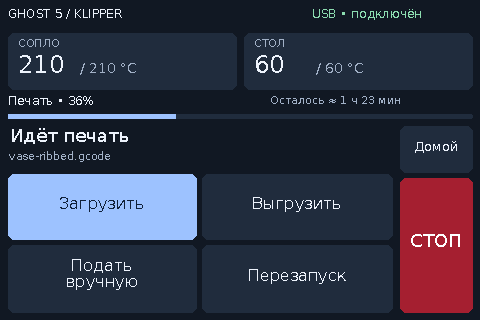

# FBG5 Native Panel

Русская сенсорная панель Klipper для штатного экрана Flying Bear Ghost 5.
Выбран интерфейс **«Прямой доступ»**: загрузка, выгрузка, ручная подача,
перезапуск и постоянно доступный программный СТОП.



## Возможности

- Постоянные текущие/заданные температуры сопла и стола, состояние USB/Klipper.
- Прогресс печати и приблизительное оставшееся время. Оценка строится по
  длительности и доле обработанного файла; это не прогноз слайсера.
- Нагрев сопла с подтверждением, выключение нагрева, загрузка, выгрузка,
  продавливание и ручная подача в обе стороны.
- Выбор шага 1/5/10/25 мм и скорости 1/2/5 мм/с.
- Подача разбивается на шаги по 1 мм с `M400`; отмена проверяется между ними.
- Запрет подачи через панель на холодном сопле, во время печати и паузы.
  Ограничения повторно проверяются внутри G-code макроса в момент выполнения.
- Перезапуск Klipper / сброс MCU с подтверждением, только в простое и с
  нулевыми заданиями температур.
- Калибровка сенсора по пяти точкам, проверка ошибки и сохранение результата.
- Отдельные соединения для статуса, отрисовки, касаний, обычных команд и СТОП.

## Статус проекта

Экспериментальная первая версия. Вывод изображения и чтение контроллера
сенсора проверены на MKS Robin Nano V1.2 / STM32F103VET6 / TFT 480×320.
Автоматические тесты используют имитацию принтера; они не подтверждают
направление конкретного экструдера, датчик температуры или работоспособность
нагревателей. Проверка касаний на физическом экране проводится при установке.

Параметры подачи рассчитаны на осторожный первый запуск **direct**:
загрузка 20 мм, выгрузка 30 мм, продавливание 5 мм, скорость 2 мм/с.
Это начальные значения, а не универсальная процедура смены филамента.
Температура по умолчанию 200 °C — её нужно выбирать для своего материала.
Автоматически при запуске службы нагрев и движение не включаются.

## Ограничения

**СТОП — программная аварийная остановка через Klipper API `emergency_stop`.**
Она обходит очередь G-code, но зависит от исправной связи сенсор → MCU → USB → ПК.
Это не независимое аппаратное отключение питания.

В используемой прошивке после shutdown отключаются подсветка и чтение сенсора.
Поэтому восстановление **после аварийного СТОП выполняется с ПК**, например
через веб-панель. Обычная кнопка перезапуска доступна в рабочем состоянии.
Проект не снимает ограничения MCU на команды в shutdown.

При физическом обрыве USB последний кадр может остаться на TFT: обновить его
с ПК уже невозможно. Надпись «подключён» в застывшем кадре не доказывает связь.
Для автономной индикации обрыва нужна дополнительная логика в MCU.

## Требования

- Уже работающий Klipper с пользовательским драйвером `fsmc_display` и
  соответствующей прошивкой MCU. Обычный upstream Klipper этого не содержит.
- Сенсор XPT2046-совместимого типа, SPI2: PB13/PB14/PB15, CS PA7.
  PB12 удерживается неактивным для второго устройства на общей шине.
- Linux/systemd, Python 3.12, DejaVu Sans, Moonraker на localhost:7125.
- Установщик рассчитан на существующую структуру `/opt/fbg5`, пользователя
  `fbg5`, службу `klipper` и ранее работающий `fbg5-screen`.

**Установщик не прошивает MCU.** Для другого принтера или другой разводки
сначала проверьте совместимость; включать конфигурацию наугад нельзя.

## Установка в существующий FBG5 host

Проверьте, что принтер простаивает, нагрев выключен, а штатный экран уже
работает через `fsmc_display`. Установщик перепроверяет это через Moonraker.

```bash
git clone https://github.com/arybashov/fbg5-native-panel.git
cd fbg5-native-panel
sudo -u fbg5 python3 -m venv /opt/fbg5/screen-env
sudo -u fbg5 /opt/fbg5/screen-env/bin/pip install -r requirements.txt
sudo /opt/fbg5/screen-env/bin/python install.py --install
```

Установщик создаёт резервную копию изменяемых файлов и выводит путь
`/opt/fbg5/backups/native-panel-.../manifest.json`. Затем устанавливает
модуль сенсора, макросы и службу панели, перезапускает Klipper/MCU и службу.
Настройки печатающей механики, PID и термодатчиков он не меняет.

При первом запуске нажмите каждый из пяти крестиков примерно на полсекунды,
затем полностью отпустите экран. До завершения калибровки кнопки управления
не работают. Калибровка хранится локально в
`printer_data/config/panel-calibration.json` и не входит в Git.

Настройки панели: `/opt/fbg5/native-panel/settings.json`. Можно добавить
`temperature`, `load_mm`, `unload_mm`, `purge_mm`, `speed`.
После изменения перезапустите **только панель**, когда её подача не выполняется:

```bash
sudo systemctl restart fbg5-screen
```

Служба включена вместе с `klipper.service`. Привязка USB из Windows в WSL и
запуск WSL при подключении принтера остаются задачей существующего host.
Windows-монитор не входит в этот репозиторий.

## Возврат к предыдущей панели

Для готового принтера в простое с выключенным нагревом:

```bash
sudo /opt/fbg5/screen-env/bin/python install.py \
  --rollback /opt/fbg5/backups/native-panel-TIMESTAMP/manifest.json
```

Подставьте точный путь из вывода установки. Проверяются SHA-256 резервных
копий и допустимые пути назначения. Восстанавливаются предыдущие файлы;
Klipper и служба панели перезапускаются. Калибровка сохраняется для будущей
повторной установки. Если Klipper уже в ошибке конфигурации и API не готов,
нужен ручной возврат файлов из указанной резервной копии: автоматический
установщик намеренно требует проверенного простоя.

## Проверка без подключения к принтеру

```bash
python3 -m venv .venv
.venv/bin/pip install -r requirements.txt
.venv/bin/python -m unittest discover -s tests -v
.venv/bin/python panel.py --preview preview.png
```

`--preview` рисует синтетическое изображение и не открывает сокет Klipper.
Тесты покрывают блокировки печати/холодной подачи, ограниченную очередь и
отмену, отдельный emergency API, калибровку, восстановление пикселей и области
кнопок. Конфигурация с макросами дополнительно проверена в offline-режиме
Klipper с MCU dictionary установленной прошивки.

Для чтения сырых координат **без нагрева и движения**:

```bash
/opt/fbg5/screen-env/bin/python panel.py --probe 25
```

Диагностика работающей панели:

```bash
systemctl status fbg5-screen
sudo journalctl -u fbg5-screen -n 30
cat /opt/fbg5/printer_data/logs/panel-state.json
```

## Происхождение и лицензия

GPL-3.0-or-later; см. [LICENSE](LICENSE).

Модуль [klipper/fsmc_touch.py](klipper/fsmc_touch.py) — неизменённая работа
Aregus393, GPLv3, commit
`e1836310fbebd004434cb40d6e2ef4353a0df080` из
[Aregus393/klipper](https://github.com/Aregus393/klipper/tree/fb5-native-display).
SHA-256: `9af587bc1745679ebed7ab4bd91a94f80154b39e8821e1f6a91b01e2f18b174e`.

Базовая реализация вывода и описание оборудования:
[FB5-klipperscreen-for-native-display](https://github.com/Aregus393/FB5-klipperscreen-for-native-display).
Этот проект использует тот же низкоуровневый вывод, но рисует собственный
небольшой интерфейс и не запускает GTK/KlipperScreen/Xvfb.

[Документация Klipper API](https://www.klipper3d.org/API_Server.html).
